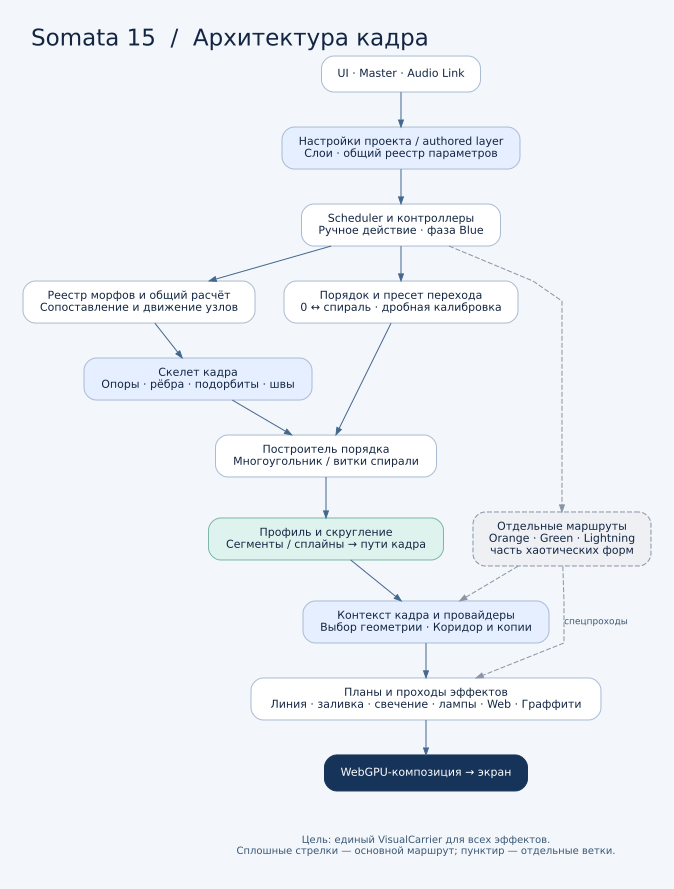

# Somata 15 — суть проекта

Somata — браузерный инструмент для создания живой процедурной графики. Вместо рисования каждого кадра пользователь задаёт правила: сколько у фигуры вершин, как они соединяются, по какой траектории движутся, какой профиль получает линия и как она реагирует на звук. Несколько слоёв складываются в композицию, а **Коридор** превращает форму в последовательность масштабированных и повёрнутых копий. Результат — графика, которую можно менять вручную, анимировать морфингом или связать с аудио.

**Главная идея: многоугольник — это спираль нулевого порядка.** Морфинг отвечает за движение и соответствие вершин, рёбер и орбит. Порядок отвечает за то, как этот скелет становится спиралью. Профиль отвечает за видимую линию на скелете. Коридор размещает копии готовой формы. Эти решения независимы: смена порядка не должна перезапускать синий морф, а смена профиля не должна менять топологию фигуры.

## Что пришло из старой архитектуры, а что добавилось

| Основа | Что сохранилось и как это выглядит в версии 15 |
|---|---|
| Старая схема `authored → frame → passes` | Настройки проекта и расчёт текущего кадра остаются разными сущностями. Интерфейс меняет состояние; рендер читает представление кадра (`frameCtx`) и строит команды эффектов. Scheduler запрашивает следующие кадры. |
| Эталон геометрии 13.2 | При выключенном «Свинчивании» спираль строится из независимых ветвей. В штатном статическом построении конец периода получается поворотом и масштабированием начальной опоры; это не поворот всей фигуры и не искусственная перемычка. |
| «Фундамент» и `14.txt` | Целевая цепочка `Geometry Logic → GeometryFrame → Profile → VisualCarrier` частично воплощена: ручной и синий морф используют общий расчёт опор, построитель порядка и подготовленные пути. `VisualCarrier` здесь — целевой контракт, а не название одного объекта, через который уже проходит весь рендер. |
| План маршрутизации параметров | `SomataParameterRegistry` описывает общие параметры и их доступность. Рядом существуют специальные и исторические обработчики: сам факт регистрации параметра не означает, что все контроллеры вычисляют его одинаково. |

## Три независимых выбора

**Тип морфинга** определяет судьбу узлов. Сейчас их семь: «Топологический», «По окружности», Fade, «Слайдшоу», «Неразрывный — фазово-окружностный», «Неразрывный, согласованный» и «Неразрывный, согласованный из центра». Топологический допускает движение по хорде, окружностный — по дуге. Fade смешивает две формы, а «Слайдшоу» строит форму по параметрам текущего кадра. Фазово-окружностный использует копии, следующие за отделившимися витками на высоких порядках. Два согласованных используют β для согласования периода: в обычном новая ветвь выходит из существующей со смещением, в варианте «из центра» растёт из центра. В последнем растёт и толщина нового штриха, включая «Граффити» и крупные экземпляры Коридора.

**«Порядок построения спирали»** задаёт геометрию: «Простой», «Развёртывание», «Морские водоросли» и «Ведьминский». **«Тип перехода»** задаётся отдельно: «Послойный», «Честный», «Красивый». Для простого построения послойный режим переносит соответствующие сегменты поворотом и масштабом. Для художественных построений послойный вариант сохраняет их исходное движение Коридора, а «Честный» и «Красивый» меняют последовательность этапов перехода, не заменяя геометрию. Дроби `−1 < порядок < 1` позволяют вручную посмотреть промежуточный кадр выбранного пресета; стрелки листают целые порядки. Синий морф начинает автоматическую смену порядка с начала фазы, а анимируемый переход использует длительность слоя или длительность фазы при синхронизации. Удержание порядка ограничивает автоматический выбор цели, а не ручной ввод.

**«Свинчивание»** меняет построение спирали, а не тип морфа. По умолчанию оно выключено; тип морфинга — «Неразрывный, согласованный», переход к нулю — «Послойный», минимальное удержание — одна фаза. В сохранённых проектах явный выбор сохраняется. Фокус Коридора — опора для преобразований копий, а не заморозка геометрии слоя. Пресеты развёртывания используют собственную опору на копии, ближайшей по масштабу к фигуре без Коридора.

## Карта кода: от действия до изображения

| Участок | Ответственность | Где искать |
|---|---|---|
| Настройки и параметры | Слои, палитры, режимы, диапазоны и связи; различие сохранённых данных и значений кадра | `js/core/state.js`, `defaults-layers.js`, `parameter-routing.js`, `parameter-matrix.js`, `palette.js` |
| Время и выбор источника | Запрос кадра, фаза, временная смена порядка; выбор активного источника геометрии слоя | `js/core/scheduler.js`, `morph-controller.js`, `js/morph-runtime/manual-morph.js` (ручной морф), `js/morph-runtime/blue/` (Blue Morph: интерполяция, цели, воспроизведение, интерфейс), `js/render/morph-provider-service.js` |
| Морф и скелет | `prepareAnchors`, сопоставление опор, правила рождения, движения и сведения | `js/morphs/types/`, `js/morph-runtime/registry.js`, `unified-runtime.js`, `morph-mode.js`, `js/geometry/skeleton-runtime.js`, `morph-math.js`, `morph.js` |
| Порядок и профиль | Пресет перехода, построение спирали, наложение сегментного или сплайнового профиля, скругление стыков | `js/core/spiral-zero-transition.js`, `spiral-zero-presets/`, `js/geometry/spiral-order-builder.js`, `js/geometry/orbit-builder.js` (`buildOrbitPolylines`), `js/geometry/spiral/` (несущие, профиль, скругления), `js/geometry/profile-model.js`, `spline-rounding.js`, `frame-paths.js`, `frame-contour.js` |
| Коридор и композиция | Преобразования экземпляров, `frameCtx`, маршрутизация геометрии и проходы эффектов | `js/corridor/`, `js/render/corridor-copy-frame.js`, `main-pipeline.js`, `render-graph.js`, `*-plan.js`, `*-pass.js` |
| Вывод | Ресурсы кривых, отрисовка и композиция WebGPU; в коде также есть маршруты восстановления вывода | `js/gpu/` (каждый рендерер — свой модуль), `js/core/backend-policy.js`, `js/render/main-pipeline.js` |
| Проекты и интерфейс | Плейлист, загрузка/сохранение, морф проектов (Green), панели и контролы | `js/project/`, `js/ui/`, `js/app/boot.js` |

Подробная карта модулей, порядок инициализации и способы проверки — в [Code_Map.md](Code_Map.md).

## Инварианты для следующих изменений

- **Скелет — источник топологии.** Нельзя терять рёбра замкнутых орбит, насильно замыкать открытые швы или скрывать зазор подменой координат в отладочном скелете. Проверять стыки нужно после преобразований соседних копий Коридора.
- **Порядок и фаза — разные состояния.** После завершения ручной правки порядка временный переход отдаёт кадр обратно выбранному Blue Morph; его часы и опора Коридора не сбрасываются. Дробная калибровка не запускает весь переход заново.
- **Эффекты следуют за формой кадра.** Линия и лампы должны использовать согласованные пути и экземпляры Коридора. «Ключевое» показывает только ключевые точки, «На изломах» добавляет лампы на изломах. Исчезнувший излом запускает затухание от текущей яркости, не дожидаясь её максимума. Скругление меняет контур, а не скелет.
- **Не выдавать общую схему за полную унификацию.** В рендере остаются отдельные маршруты независимых Orange и Green, Lightning и части хаотической геометрии. При правках проверять реальные провайдеры и потребителей, а не только отдельную формулу.

## База релиза и проверка

Модульная сборка 15.1 — это 15 с перестроенным кодом: ES-модули с явными импортами вместо 138 скриптов с общей глобальной областью, три монолита разрезаны по доменам, пустые `catch` и лишние проверки `typeof` убраны. Алгоритмы, формат проектов и `default.plist` не менялись. Равенство с исходной 15 проверено: 3354 вызова `buildOrbitPolylines` совпадают побитово (сетка параметров и все слои 22 проектов `default.plist` на четырёх порядках), поведенческий набор `tests/morph-skeleton.test.cjs` выдаёт те же 35 результатов с теми же счётчиками, скриншоты 22 проектов в WebGPU (SwiftShader) совпадают с одним из прогонов исходной версии. Подробности — в [Code_Map.md](Code_Map.md).

### Исходная версия 15

Версия 15 собрана из **14.2 Bend Lamp Timing**. Обновлены обозначение версии, метки ресурсов и документация; алгоритмы и формат проекта не менялись. Запуск: `python -m http.server 8000` из папки сборки, затем открыть локальную страницу в браузере с WebGPU. Команды тестов — в `README.md` сборки.

При сборке выполнены все пять тестовых сценариев из `tests/`, в том числе прямое сравнение 900 статических конфигураций с 13.2 (ветви, профиль и толщина). Это проверки расчётов и подключения маршрутов, а не визуальный прогон WebGPU и не замер производительности.

Основания: `ARCHITECTURE.md`, `Фундамент.txt`, `14.txt`, план маршрутизации из архива «Суть», исходники 13.2 и исходники релизной базы 14.2 Bend Lamp Timing. Старые документы описывают также замысел и исторические состояния, поэтому текущий статус сверялся с кодом.
